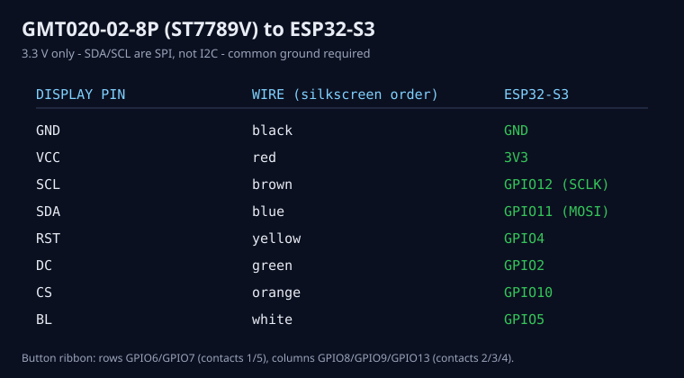
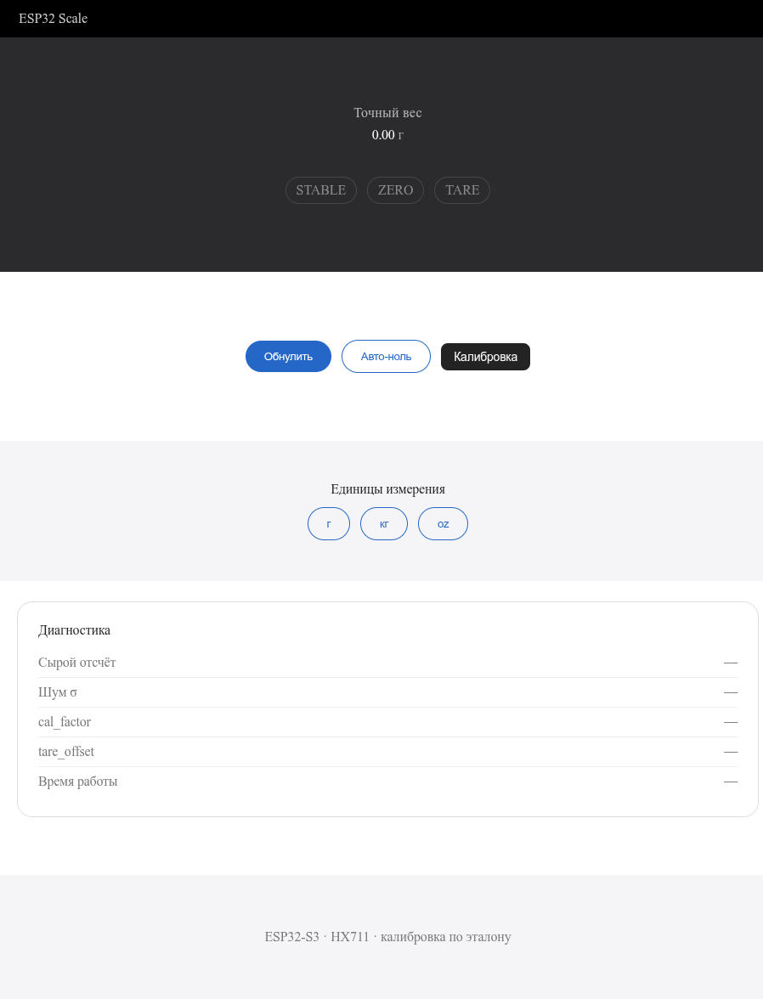

# ESP32 Scale

High-precision electronic scales on an ESP32-S3: a 6 kg load cell, an HX711
converter, custom firmware on ESP-IDF and a web interface.

Nothing here comes from ESPHome, Arduino or any off-the-shelf measurement
library — ESP-IDF and the code in this repository only.

> **ST7789 front panel:** the 2.0" GMT020-02 display firmware is released as [v1.4.0](https://github.com/zavaruev/esp32-scale/releases/tag/v1.4.0) on branch `display-st7789`. The default `main` branch keeps the SSD1306 OLED variant.

## Display and wiring



The 2.0\" GMT020-02 front-panel display is documented in [docs/pinout.md](docs/pinout.md).
The v1.4.x firmware for it is released on branch `display-st7789`.



## What the instrument actually shows

Not the numbers from the specification, but measured ones. The method is a
paired measurement: the empty platform is captured as its own point, the
reference is placed separately, and the difference in counts is what gets
computed.

| Parameter | Value | How it was obtained |
|---|---|---|
| Sampling rate | **11.3 Hz** | limited by the hardware, see below |
| Noise of one sample | **110 mg** | 507 samples on a motionless platform |
| Noise of the device-side mean | **15 mg** | mean over 45 samples = 4.0 s |
| Accuracy on a 73.03 g reference | **+0.14 g (+0.20 %)** | two independent pairs, 9 mg apart |
| Time to a reading | **1.15 s** | step response, see below |
| Resolved value | **0.05 g** | the target, measured against a reference of known mass |

### Time to a reading

The figure is correct 1.15 s after a weight is placed, and that is measured on a
recorded step rather than calculated — `tools/settle_sim.py` runs the real filter
chain over `logs/coins2.log`, which contains a 30.6 g reference placed on a
platform already under measurement:

| Averaging window | Time to within 0.05 g | Noise once settled |
|---|---|---|
| 45 samples (fixed, earlier) | 4.35 s | 11 mg |
| progressive (current) | **1.15 s** | **11 mg** |

A simple running mean needs N samples to absorb a step of any size, because it
has to push the old ones out — so N *is* the response time. The window is
therefore not fixed: it shortens to 9 samples while the reading is still moving
and grows back to 45 once it has settled, which is where the low noise is
wanted. The settled noise is the same either way, so the speed is not bought
with accuracy.

The window is shortened on whether **the mean itself** has stopped moving. Keying
it off the filter's EMA instead — the obvious choice, since the EMA already
distinguishes moving from still — is measurably wrong: the EMA settles within a
couple of samples while the mean is still 30 g short, so the window starts
growing straight away and holds the pre-step samples in behind it. Measured on
the device, a 73 g placement then climbed from 36 g to 73 g over 3.6 s.

The page adds about 0.5 s on top: it polls every 500 ms and averages two polls.

One honest caveat: the empty-platform point wanders by **195 mg** between
sessions. That is the real limiter of accuracy, not the instrument, whose own
uncertainty is 15 mg. Hence: **tare before every weighing.**

## Hardware and wiring

HX711 to the ESP32-S3:

| HX711 | ESP32-S3 | Note |
|---|---|---|
| VCC | **3V3** | the HX711 drives DOUT at its own supply level; on 5 V that puts 5 V on GPIO16 |
| GND | GND | |
| DOUT | GPIO16 | |
| SCK | GPIO17 | |

6 kg load cell:

| Wire | Goes to |
|---|---|
| black | E+ |
| red | E− |
| green | A− |
| white | A+ |
| yellow | shield to GND |

**Place the load dead centre on the platform.**

### Why the rate is not higher than 11.3 Hz

The HX711 has no configuration register. The rate is set by the level on pin
15: 0 for 10 Hz, 1 for 80 Hz. Pin 15 is tied to ground, so the instrument runs
at 11.3 Hz permanently. Rewiring it would give 80 SPS but would not improve
accuracy: accuracy is set by the noise and by the length of the averaging
window, not by the sampling rate.

## Build and flash

```bash
source ~/esp-idf/export.sh
cd ~/ESP32_Scale
idf.py set-target esp32s3      # first build only
idf.py build

PORT=/dev/serial/by-id/usb-1a86_USB_Single_Serial_595B069397-if00
idf.py -p "$PORT" -b 460800 flash
```

**460800, not 921600** — on the CH9102 anything faster is unreliable.

Before the first flash, create the WiFi settings file:

```bash
cp main/credentials.h.example main/credentials.h
# fill in SSID and password
```

`main/credentials.h` is in `.gitignore` and never reaches the repository.
`main/credentials.h.example` is the only such file that is tracked.

## Web interface

The device joins the `home4` access point and takes an address over DHCP, at
the moment of writing `http://192.168.22.123/`.

- The page is served gzip-compressed: **7 765 bytes** instead of 25 948.
- Every **500 ms** the device is polled and the reading updates.
- **Zero** is the tare button.
- **Auto-zero** turns the zero-tracking on and off.
- The reading turns **green** once the weight is measured and the figure has
  settled. It is tied to the same state as the HOLD chip, not to a separate
  threshold, and the colour is only a second channel — the STABLE and HOLD chips
  carry the same information in words.
- The moon/sun button in the top bar switches between day and night. The choice
  is kept in `localStorage`, so it belongs to the browser and to this origin: a
  different DHCP lease on the instrument loses it and the page falls back to the
  system preference.
- **Firmware** and **Diagnostics** are collapsed by default, so the whole page
  fits a phone screen without scrolling.

The 500 ms interval was set from measurement, not from the default. Polling at
100 ms was previously found to corrupt 10.3 % of raw samples, but that was before
the interrupt mask around the HX711 read and the transmit-power limit, and after
those fixes the same experiment reads:

| External poll rate | Median noise of the device's own mean |
|---|---|
| none | 15.9 mg |
| every 1000 ms | 16.0 mg |
| every 500 ms | 15.9 mg |
| every 100 ms | 16.5 mg |

At 500 ms the polling is not measurable in the noise at all.

If the device is connected but the address is not that one, look at the serial
console — it prints the address it was given.

**There is no access-point fallback at the moment** — it is disabled on
purpose, by request. The device acts as a station only.

## Updating the firmware

The device has **two 2 MB application slots**. An update is written to the slot
that is not running, verified, and marked to boot on the next restart. The
running slot is never written, so a failure at any point leaves a device that
still starts.

From the web interface: open the page, expand **Firmware**, choose a
`build/esp32_scale.bin` and watch the progress bar. Restart when it says
verified.

From the command line:

```bash
python3 tools/ota_push.py build/esp32_scale.bin http://192.168.22.123
```

Transfers are resumable, and that is the design rather than a convenience. The
link to the access point loses anywhere from 0 to 100 % of its packets — measured
2026-10-09 — and the image is about 950 KB, so a single request would have to
survive the whole run of bad luck in one stretch. Instead the client asks the
device how much has landed and continues from there, so a dropout costs one
chunk. Measured: 993 168 bytes in about two minutes at 3–8 KB/s, over the same
link the web page itself struggles with.

The device does not trust the client. It refuses an image larger than the slot,
a chunk that would run past the declared size, a transfer that ends short, and
anything that fails `esp_image_verify()` — which walks the segment table and
checks the SHA-256 appended to the image. A lost packet cannot pass as a
finished upload.

**Rollback.** If a new image fails to boot, the bootloader reverts to the
previous slot by itself on the next restart — no USB, no person. This matters for
a device assembled into a bench. The application confirms itself from `ota_init()`
once it has run, otherwise every update would revert.

> **Migrating an existing device.** An instrument that was flashed before this
> feature still has a single 1 MB slot, and there is nowhere to receive a new
> image. Flash `partitions.csv` over USB once — `idf.py flash` does it — and from
> then on updates go over the air.

`partitions.csv` keeps `nvs` at `0x9000` and `phy_init` at `0xf000`, exactly where
the old single-slot table had them. Both hold data that cannot be regenerated:
the scale calibration and the WiFi calibration. Moving either would silently
reset the instrument on the first boot after the migration.

**Note on security.** The HTTP interface has no authentication, so anything that
can reach the device on the network can replace its firmware. That is the same
posture as the rest of the interface, which also allows tare and calibration
without a password. It is a deliberate choice for a device on a home network,
and it is worth revisiting if the instrument ever goes onto a network that is not
yours.

## Front-panel buttons

The six membrane keys on the front panel are scanned by a task on core 1; they
never touch the HX711 bus. Short presses do the following:

| Key | Action |
|---|---|
| `ЕД` | Switch between automatic units and ounces. AUTO shows grams below 1 kg and kilograms at/above 1 kg |
| `СУМ` | Open the calibration screen; **hold for 1.5 s** to start calibration |
| `0` | Zero the current reading |
| `Т` | Take a tare; **hold for 1.5 s** to toggle auto-zero (AZT) |
| `ИТТ` | Hold / release the displayed result |
| `СБР` | Release hold and return to the weighing screen |

With an empty, stable platform the display goes to an idle clock after 60 s:
large `ЧЧ:ММ` plus the date. Time is taken from NTP (`pool.ntp.org`, MSK / UTC+3);
until it is synced the clock shows `--:--`. Any key press, or a load appearing on
the platform, returns to the weighing screen.

The same ribbon carries the display wiring. See `docs/pinout.md` for the
ST7789 (GPIO 2/4/5/10/11/12) and OLED variants.

## Serial console

115200 baud. The useful commands:

| Command | Action |
|---|---|
| `c` | current reading, noise, zero and stability flags |
| `t` | tare |
| `d [min]` | watch zero stability |
| `m [g]` | paired calibration with automatic load detection |
| `w` | filter constants and state |
| `R` | dump raw samples recorded by the measurement task |
| `h` | HTTP server self-test |
| `x 0\|1` | suspend / resume the WiFi radio |
| `T <dBm>` | transmit power at runtime |
| `G 0\|1` | interrupt mask around the HX711 read |
| `s` | WiFi scan: SSID, RSSI, channel, encryption |
| `k <password>` | replace the password without rebuilding |
| `b <MAC>` | bind to a specific access point, `b off` to clear |
| `p 0\|1`, `a 0..2` | PMF and authentication mode |
| `L 0\|1`, `M <MAC>` | WiFi debug log and MAC override |

For live output instead of redirecting to a file:

```bash
python3 tools/serial_console.py --send 'R' --seconds 50
```

## HTTP API

| Method and path | Purpose |
|---|---|
| `GET /` | the page |
| `GET /api/weight` | current reading |
| `POST /api/tare` | tare |
| `POST /api/unit?u=0\|1\|2` | units: 0 = g, 1 = kg, 2 = oz |
| `POST /api/azt?off` | switch auto-zero off; no parameter switches it on |
| `POST /api/cal/start[?mass=g]` | calibration wizard |
| `GET /api/cal` | calibration progress |
| `POST /api/reboot` | restart |
| `GET /api/ota` | firmware status: slot, versions, bytes written |
| `POST /api/ota?size=N` | open a transfer, erasing the spare slot |
| `POST /api/ota?offset=N` | send one chunk at that offset |
| `POST /api/ota?commit=1` | verify and mark the new slot to boot |
| `POST /api/ota?abort=1` | discard a partial transfer |

None of these require authentication. See the note under *Updating the firmware*.

`/api/weight` returns `value`, `grams`, `counts`, `sigma_mg` (noise of a single
sample), plus `avg_grams`, `avg_sigma_mg` and `avg_n` — the device-side mean and
its standard error. **Look at `avg_sigma_mg`: it states outright how far the
figure can be trusted.**

## Code layout

| Module | Role |
|---|---|
| `main/hx711.{c,h}` | HX711 driver, exactly 25 clocks, no configuration writes |
| `main/scale_filter.c` | median(5) → adaptive EMA → auto-zero → deadband |
| `main/weight_task.c` | measurement task on **Core 0**, NVS, progressive mean |
| `main/ota.c` | writing an image into the slot that is not running |
| `main/web_server.c` | WiFi and HTTP on **Core 1** |
| `main/scale_app.c` | initialisation and the serial console |
| `main/web/index.html` | interface source, readable and commented |

The core split is not a style preference but a necessity: **Core 0 does
measurement only, Core 1 does networking and the interface only.** The
measurement task wakes continuously, and with the network stack on the same core
it went hungry and stopped processing TCP acknowledgements — the page would
load 4 500 bytes and then stop.

`main/index_html.h` is generated from `main/web/index.html` by
`tools/embed_web.py` during the build, and is tracked in the repository so a
fresh clone builds without Python. **Edit the HTML, not the header.**

## Known limitations

- **The empty-platform point wanders 195 mg between sessions.** This is the
  limiter of accuracy. Tare before weighing.
- **WiFi is unreliable in this location.** Measured: loss swings between 0 and
  100 % and the link wanders on its own over time. Transmit power has been
  tuned (17 dBm, up from 8), but software cannot fix the physics.
- **A multimeter is not good enough to diagnose the cell.** The expected signal
  for 73 g is about 80 µV, and an ordinary meter reports its own error at that
  level. An oscilloscope is needed.
- **The access-point fallback is disabled.** If the station cannot connect, the
  device will have no web interface. Re-enabled by setting `AP_FALLBACK_ENABLED`
  in `main/web_server.c`.
- **The page and the firmware are coupled.** The interface expects `avg_grams`
  from the API. Flash an old page from a browser cache onto new firmware and the
  figure comes up empty.
- **The firmware interface is unauthenticated.** Anything on the network that can
  reach the device can replace its firmware. Acceptable on a home network, worth
  revisiting anywhere else.
- **The USB link is unreliable on this board.** It has dropped off the bus
  mid-session more than once, while the device itself kept running on WiFi. A
  `flash` that reports nothing is usually this, not the build — check that the
  port still exists before re-running it.

## Where the measurement history lives

`AGENTS.md` is the project's working notebook: every measured number, every
mistake that was stepped in, and every rejected hypothesis together with what
disproved it. It also records why the rate is stuck at 11.3 Hz, why the read
needs an interrupt mask, and why averaging is done in the device rather than in
the browser.

`docs/stage1-findings.md` holds the stage 1 results: hardware suitability,
calibration, and calculations of achievable accuracy.
